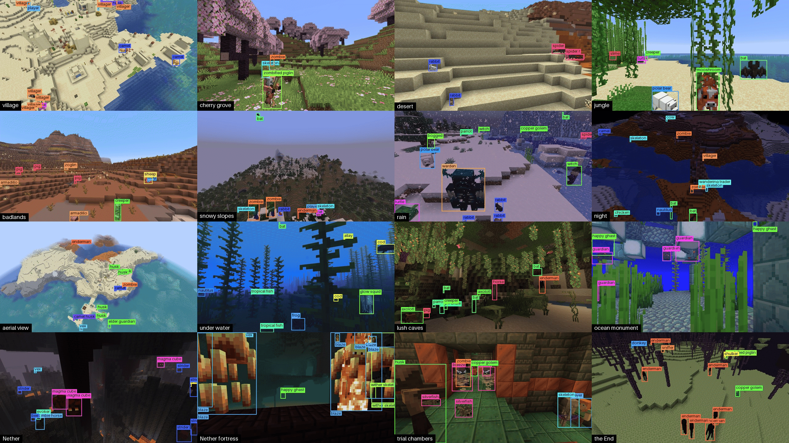
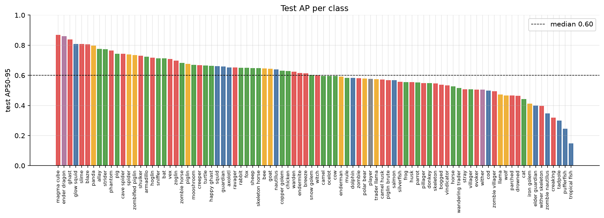
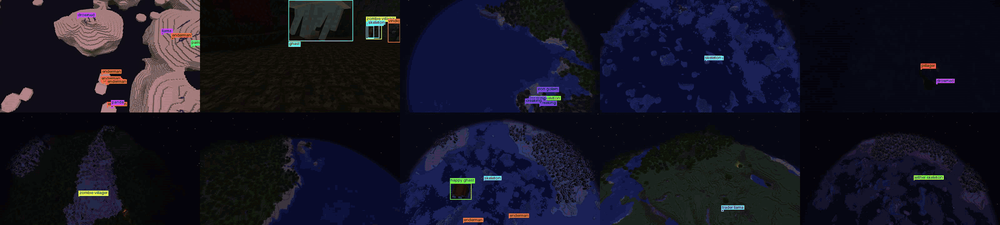

# Minecraft Mob Detection

[](https://huggingface.co/datasets/OlleOltorp/minecraft-mobs)
[](https://huggingface.co/OlleOltorp/rfdetr-minecraft-mobs)
[](https://www.minecraft.net/)
[](https://fabricmc.net/)
[](https://www.python.org/)
[](https://github.com/OlleOltorp/minecraft-mob-dataset/actions/workflows/ci.yml)
[](LICENSE)

A dataset of every Minecraft mob, labelled exactly by the game itself, the tool that makes it,
and an RF-DETR model trained on it.

**[Dataset](https://huggingface.co/datasets/OlleOltorp/minecraft-mobs)** ·
**[Model](https://huggingface.co/OlleOltorp/rfdetr-minecraft-mobs)** ·
**[Dataset notebook](notebooks/01_dataset.ipynb)** ·
**[Baseline notebook](notebooks/02_baseline.ipynb)**


*Flights past mobs in places the model never saw. Left: the true boxes, from the game.
Right: the model.*

## The dataset



- **49,861 pictures** (1280×720) of all 87 mobs of Java 1.21.11 and the player
- **177,312 labelled mobs**, each with a box and a pixel mask
- **Every biome** (64), 38 kinds of structure, caves, under water, the Nether and the End
- Day, night, dusk and dawn; clear, rain and thunder; three brightness settings
- **Split by place:** test pictures come from parts of the world no training picture shows

| split | pictures |
|---|---:|
| train | 39,158 |
| validation | 5,120 |
| test | 5,583 |

Counts by biome, camera, light, distance and mob are on the
[dataset page](https://huggingface.co/datasets/OlleOltorp/minecraft-mobs) and in the
[dataset notebook](notebooks/01_dataset.ipynb).

## Use the dataset

```python
from datasets import load_dataset

ds = load_dataset("OlleOltorp/minecraft-mobs", split="train")
picture = ds[0]["image"]  # PIL image
mobs = ds[0]["objects"]  # one dict per mob: category, bbox, segmentation, ...
```

Boxes are COCO `[x, y, width, height]` in pixels, masks COCO run-length encoding. Objects with
`iscrowd = 1` are ignore regions (mobs too hidden or dark to see), not mobs to find.

## Use the model

```python
import json
from huggingface_hub import hf_hub_download
from rfdetr import RFDETRLarge

repo = "OlleOltorp/rfdetr-minecraft-mobs"
model = RFDETRLarge(pretrain_weights=hf_hub_download(repo, "checkpoint_best_total.pth"))
names = json.load(open(hf_hub_download(repo, "classes.json")))

detections = model.predict("screenshot.png", threshold=0.5)
print([names[c] for c in detections.class_id])
```

`model.predict` squeezes the picture to a square. For the scores below, use
`mobdataset.model.infer.predict` from this repo, which keeps the 16:9 shape the model was
trained on.

## Results

RF-DETR Large fine-tuned for 10 epochs, scored on the 5,583 test pictures.

| mAP50-95 | mAP50 | mobs found at score 0.5 |
|---:|---:|---:|
| 0.602 | 0.741 | 73 % |

- **Size matters most:** mobs within 8 blocks score 0.78, past 128 blocks 0.12.
- **Hardest places:** aerial views (0.33) and under water (0.48); caves score best (0.74).
- **Weakest classes:** small water mobs with few labels and look-alikes (creaking, wither
  skeleton).



Everything else (training curves, mix-ups, scores by distance, size and place, pictures it
gets right and wrong) is in the [baseline notebook](notebooks/02_baseline.ipynb) and
[`baselines/rf-detr/`](baselines/rf-detr/results.md).

## How it works



*Ten game windows capturing at once.*

1. **Map the world.** The game's own `locate` maps every biome and structure of a normal world
   without generating it.
2. **Pick places and split them.** Spots at least 300 blocks apart; whole 512-block tiles go
   to one split, so test is truly unseen terrain.
3. **Generate the terrain** around every spot first ([Chunky](https://modrinth.com/plugin/chunky)),
   so no picture waits for terrain or shows holes.
4. **Capture.** Up to ten game windows place mobs where they would live (and any mob anywhere,
   for variety), with the game's random looks and poses frozen mid-step, then take a picture.
5. **Label.** A Fabric mod draws the same frame again with each mob in its own flat colour:
   every visible pixel of every mob, so boxes and masks are exact, even behind leaves or other
   mobs.
6. **Check.** Each label is compared with the same shot without the mobs (a *clean plate*);
   mobs with nothing visible become ignore regions.

## Make your own

Pick the mobs, biomes, times, weathers, camera heights and size you want; one command does the
rest. Made and tested on Windows; training needs an NVIDIA GPU (the baseline used an RTX 4070).

**You need:** Minecraft Java Edition, Java 21, Python 3.12 with [uv](https://docs.astral.sh/uv/),
and a [Fabric](https://fabricmc.net/) 1.21.11 server with
[Chunky](https://modrinth.com/plugin/chunky).

**1. Set up**

```bash
git clone https://github.com/OlleOltorp/minecraft-mob-dataset
cd minecraft-mob-dataset
uv sync
cp .env.example .env    # then fill in the server and game folders and the RCON password
(cd mod && ./gradlew build)
uv run mobdataset doctor
```

`doctor` checks every part and says how to fix what is missing.

**2. Try the tiny dataset** (about 200 pictures, a quarter of an hour)

```bash
uv run mobdataset make tiny
```

**3. Make your own**

```bash
uv run mobdataset new my-set --from plains --mobs hostile --pictures 2000
uv run mobdataset make my-set --windows 4
```

`new` writes `datasets/my-set.toml`; every setting in it is explained in
[`datasets/full.toml`](datasets/full.toml). `make` runs every step in order (map the world,
plan, generate terrain, capture, export), starting the server and game windows itself, and
picks up where it stopped. The result is COCO and Parquet in
`data/datasets/my-set`.

| preset | what | pictures |
|---|---|---:|
| `tiny` | a few land biomes, to test a setup | ~200 |
| `plains` | grassland at all times and weathers | ~2,000 |
| `caves` | lush caves, dripstone, deep dark | ~2,000 |
| `ocean` | above and under water | ~2,000 |
| `nether` | all five Nether biomes | ~2,000 |
| `full` | the published dataset | 49,861 |

## Train and evaluate

```bash
uv sync --extra train
uv run mobdataset train data/datasets/my-set --config baselines/rf-detr/config.toml
uv run mobdataset evaluate data/datasets/my-set --weights runs/<run>/checkpoint_best_total.pth
uv run mobdataset session run --dataset full --clients 2 -- mobdataset flythrough village-plains
uv run mobdataset flythrough village-plains --video --weights runs/<run>/checkpoint_best_total.pth
```

`train` fine-tunes RF-DETR from its COCO weights, `evaluate` scores a split with the COCO tools,
and `flythrough` flies past mobs on real terrain (in a game session), then films true and model
boxes side by side (the videos above). The scenes are in [`config/flythrough/`](config/flythrough).

## Repository

| folder | what |
|---|---|
| [`src/mobdataset/`](src/mobdataset) | the `mobdataset` command: world, capture, export, training |
| [`mod/`](mod) | the Fabric mod that draws the label images |
| [`datasets/`](datasets) | dataset presets |
| [`config/`](config) | mobs, game and camera settings, fly-through scenes |
| [`baselines/rf-detr/`](baselines/rf-detr) | the baseline's settings and results |
| [`notebooks/`](notebooks) | the dataset and baseline analyses |
| [`protocol/`](protocol) | how the mod and Python talk |

## Licence

Code: [MIT](LICENSE). Dataset and model weights: CC BY-NC 4.0.
Minecraft is a trademark of Mojang; this project is not affiliated with or endorsed by Mojang
or Microsoft.

## Citation

```bibtex
@misc{oltorp2026minecraftmobs,
  author = {Olle Oltorp},
  title = {Minecraft Mobs: an object detection dataset with exact labels},
  year = {2026},
  publisher = {Hugging Face},
  url = {https://huggingface.co/datasets/OlleOltorp/minecraft-mobs}
}
```
